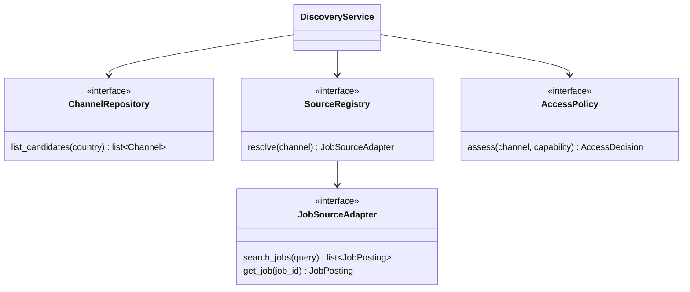

# Source catalog — employers, channels and what we may read

Ownership: the layer between "a brand hires in Chile" and "JobBot can read this listing".
It holds public knowledge only: no candidate data, no credentials, no application.

The catalog exists because a vacancy's address is unstable. The same opening shows up in a
corporate page, a white-label tenant and an agency's board, while an employer changes
platform without changing its brand. Before deciding what to integrate, we need the
sources written down with the evidence behind each one.

```bash
uv run jobbot portals catalog import data/sources-cl.example.yaml          # dry run
uv run jobbot portals catalog import data/sources-cl.example.yaml --apply  # writes
uv run jobbot portals catalog list --ats trabajando
uv run jobbot portals catalog plan --country CL   # what could be explored, and why not
```

## What the seed is, and what it is not

`data/sources-cl.example.yaml` is the compact inventory of the 2026-10-12 research:
194 employers and brands, 249 channels, 15 sectors, plus 257 brands with no verified
channel yet. It is **not** a census of Chilean employers, **not** proof that any channel
has open vacancies, and **not** permission to extract anything.

The `read` column is the state of one reading on one day, never a verdict about the
portal:

| state | meaning |
| --- | --- |
| `fetched` | content came back — says nothing about listing completeness |
| `js_required` | the listing renders client-side; plain HTML has no vacancy |
| `no_content` | answered, but with nothing usable |
| `reader_error` | the reader failed (403, 404, timeout): revalidate, never bury |
| `pending_destination` | official link whose destination was not resolved yet |

A 403 and an empty page are different from "this employer is not hiring", and the model
keeps them apart all the way to the discovery report.

## Mapping to the models that already exist

New types were added only where the existing ones could not carry the fact.

| Catalog type | Existing model | Why it is not the same |
| --- | --- | --- |
| `Employer` | `companies.models.CompanyRecord` | The record owns its sites; an employer may share one. Aliases and a group link with evidence have no place in it. |
| `Channel` | `companies.models.CareerSite` | A `CareerSite` belongs to exactly one company and drops the query string, which is where a tenant lives (`?c=cencosud`, `?company=AMSAP`). |
| `EmployerChannel` | — | The many-to-many link. A group channel publishing for its subsidiaries, and an agency publishing for clients, are both this. |
| `PlatformBinding` | `portals.detect.AtsKind` | `AtsKind` is what JobBot can *recognise*; `ats_family` is what the page *showed*, including vendors with no detector yet (Trabajando, Aira, HiringRoom, Pandapé, Luk — see #151, #183). |
| `CapabilityAssessment` | — | What JobBot may do with this channel, one capability at a time, `unknown` until somebody checks. |
| `ChannelHealth` | `CareerSite.last_verified` | `researched_at` and `last_successful_fetch_at` are different dates, and an error has to survive as an error. |
| lifecycle `status` | `companies.models.KnowledgeStatus` | Reused as-is: candidate → active, nothing promoted by accident. |

URL rules live in `companies.urls`, next to the normalization that was already there:

- `public_url` / `canonical_key` keep their meaning (host + path, no query).
- `semantic_url` keeps the query a portal needs and drops **identified** tracking
  (`utm_*`, `trk`, `icid`, `rcm`, `source`, `src`, click ids).
- `semantic_key` is the dedup key: `www.`, a trailing slash and parameter order do not
  create a second channel, while two tenants on one host stay two channels.

## Nothing is enabled by being indexed

Every imported channel arrives `enabled: false`, and `SourceCatalog.enable()` refuses
unless that channel has a `CapabilityAssessment` recorded as `supported`. Belonging to an
ATS JobBot can read is a fact about the vendor, not about this channel. A seed that asks
for an enabled channel is an import error, and the channel is still imported disabled.

The import is pure: it returns a new catalog plus a report, so `--apply` is the only
thing that writes. The report reproduces the counts the research declared and refuses the
import when they disagree — a silent loss of sources is the failure this guards against.
Changes are reviewed as a diff (added employers, channels, links, changed channels).

## Dependency injection



`JobSourceAdapter` is the contract that already exists in
[`jobs/sources.py`](https://github.com/ljofreflor/jobbot/blob/main/src/jobbot/jobs/sources.py);
the catalog reuses it instead of starting a parallel hierarchy, and
`composition.legacy_source_factory` keeps `get_job_source` as the facade while channels
migrate to adapter keys.

- `catalog/composition.py` is the single composition point: the CLI builds repository,
  policy and registry there and injects them. The domain imports no concrete adapter and
  there is no global lookup.
- `AdapterKeyRegistry` maps an `adapter_key` to an explicit factory. Data names a key; it
  never names code to load. A key with no factory is an `UnsupportedSourceError`, which
  the service turns into an `unsupported_source` outcome.
- Tests inject an in-memory repository, a fake registry and stub adapters: the unit suite
  reaches no network and constructs no live client.

Every channel ends in exactly one outcome, and a failure never becomes an empty list:

| outcome | when |
| --- | --- |
| `found` / `empty` | the source answered, with or without vacancies |
| `error` | the adapter raised: one broken source never cancels the rest |
| `unsupported_source` | no adapter is validated for this channel |
| `blocked` / `needs_review` | the policy said no, or nobody has checked yet |
| `not_extracted` | the page is an access page, a CV inbox or a single posting |
| `disabled` / `closed` | a catalog candidate, or a channel replaced by another |

`plan` is the dry run: it reads nothing, creates no account, sends no application, and
lists every omitted channel with its reason.

## What this layer deliberately does not do

- It does not apply. `ApplicationPreparer` / `ApplicationSubmitter` are separate contracts
  in later issues; being able to read a source implies nothing about sending anything.
- It does not infer a hiring country. Spanish text and a `.cl` domain are not evidence:
  the country is a stored fact from the research.
- It does not invent slugs, tenants, APIs or ATS names, and it does not promote a brand
  from the research queue into a portal.

## Follow-ups

- Channel validation and employer/brand reconciliation (issue B).
- Discovery pilots per ATS family — Trabajando (#241), HiringRoom (#243), Buk (#242) —
  one source per family, each with its own fixture tests (issue C).
- Change tracking, coverage metrics against a versioned target universe, regional
  expansion (issue D). Coverage is never "percentage of all Chilean portals": without a
  declared denominator that number means nothing.
